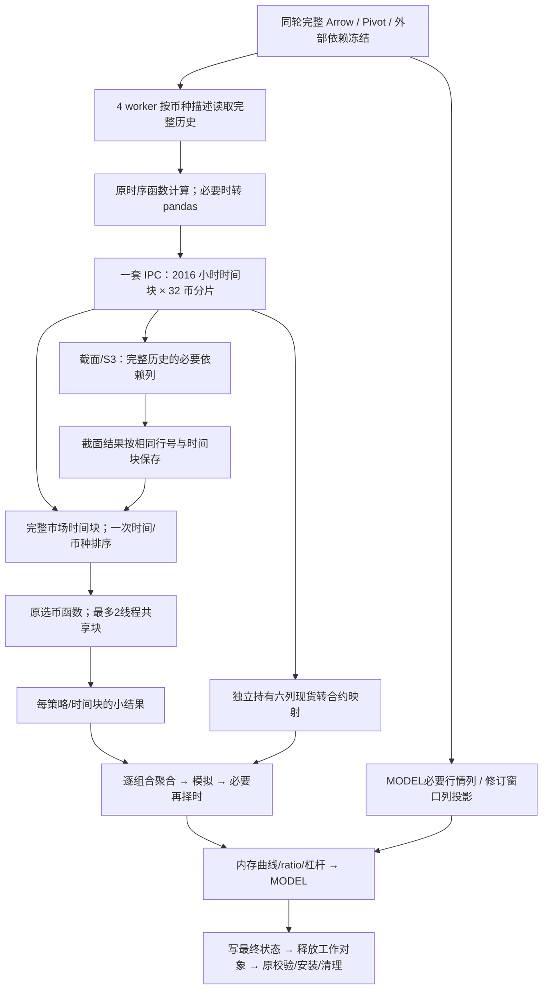

# 初始化数据管理重构：实施与人工复核

状态：**本地实现与验收完成，未部署；新入口默认仍关闭。** 三组完整测试的耗时中位数772.8→622.5秒（减少19.4%），私有输出峰值约9.64→8.09GiB，但提交峰值约5.71→7.69—8.03GiB。不能据此认定已经通过Ubuntu4c8g容量与换页性能验收。

## 1. 本轮范围

用户批准的计划：[初始化数据管理重构](2026-11-03-initialization-data-refactor-plan.md)。只重构 MODEL 全历史初始化编排，复用原 core/positions 公式和最终 snapshot 协议。账户策略参数、S3 日期、自动 bStocks、补 BNB、精度与容差不变；本轮没有新增 startup、alpha/alpha2、signals/factors/sections 修改，没有下单、通知、重启或生产数据删除。

仓管仍在 positions，策略名与参数仍在 accounts；新增两个工具文件分别管理编排与临时数据，没有另建数据库、manifest 或状态协议。现有未提交修改保留，不属于本轮审核范围。

## 2. 最终候选的数据路径

分区是下游可组合的读取单位，不等于数学上可独立计算的单位：

- 时序按币种计算完整历史，完成后才切时间块，避免重复 rolling 预热。
- 截面必须覆盖完整市场；TopK 跨时间依赖和 S3 状态仍通过原函数处理，不按币种分片独立排名。
- 截面与选币各启动一次阶段进程，传路径/配置，返回小结果路径，阶段结束才启动下一阶段；不是每策略、每块回收进程。
- 因子只有一套统一 IPC，截面另存结果列；不再经过临时输入 PKL 或 Parquet→排序 IPC 二次转换。
- 选币结果不保留整个策略池×全部块的对象列表；按组合消费和删除。选币及六列映射读取后释放所有因子块。
- 映射表必须独立持有内存，并在最后使用点收集旧 Arrow/pandas 循环引用；否则 Windows 仍会拒绝删除 mmap 文件。只复制六列映射，不复制整个因子面板。
- 子策略阶段共用一次读取的Pivot/单位；模拟结果直接交仓管。子策略、S3、MODEL最终状态仍写入未发布 snapshot，沿用共同截止校验和原子安装。
- MODEL按子策略逐个把对齐权重转CSR，避免同时保留14套dense对齐副本。全历史原始行情只投影必要列；修订输入单独读取168小时所需列。

已验证候选参数为2016小时、32币分片、总并发MODEL_JOB_NUM=4；选币最多2线程，聚合/模拟串行。仓库当前保留False/16币的原入口，不自动切换。custom/entry_exit 或关闭分块时也保留原初始化入口。正常4050续算、传统策略及手工回测默认入口不变。

## 3. core 最小人工复核

本轮相对实施前代码的独立补丁：[core-review.diff](../research/initialization_refactor_20261103/core-review.diff)。不要用整个工作区 git diff 代替此范围，仓库还包含以前的未提交定制。

本轮四文件合计65行增加、39行移除（包含提取/移动），没有额外core文件和startup修改。

其余运行代码相对计时基准的变化见[运行模块补丁](../research/initialization_refactor_20261103/implementation-review.diff)。`resources.phase`的Windows阶段日志采集器对A/B同步使用，不包含在该基准差异中；没有改变Linux资源策略。

| 文件 | 分类 | 修改与默认行为 |
| --- | --- | --- |
| core/select_coin.py | 可选数据入口 | 合并选币接受frames，现货转合约接受selection/market；source_sorted默认False，仅工具已排序输入跳过重复排序；原读写默认保留 |
| core/equity.py | 可选数据入口 | 权重/Pivot/单位可传入，返回已经保存的ratio引用；模拟数学、state0/state1及恢复点不变 |
| core/model/backtest_config.py | 可选数据入口 | 内存曲线/ratio/再择时输入，省去内部CSV/PKL往返；缺省仍原文件路径 |
| core/backtest.py | 原逻辑提取 | 提取calc_timing_leverages，simu_timing继续复用；run_backtest_multi调度不新增修改 |

没有全局取消原报告、回退或snapshot功能，故不需要恢复其他共享core代码。初始化不再使用的文件往返由新工具入口绕开；旧入口仍有消费者，不能全局删除。startup本轮0新增修改。

人工检查重点：内存输入保留原选币快照“现货转合约前”的语义；再择时仍state0→杠杆→state1；共享输入只读；source_sorted只由已排序块调用；半成品不得安装。

## 4. 验证证据与边界

研究目录：`research/initialization_refactor_20261103`；本机临时基准代码/输入/执行目录位于系统Temp下的`alphaonline-init-refactor-20261103`，生产data未清理。Python仅alpha311，冻结15m全市场同轮输入，14组合/43策略；审计钩子禁止网络，不进入交易入口。

- 88个基础/时序/截面字段、11,627,074行严格逐值一致，43份选币一致。
- 共享排序前后全部341份选币分块物理行序与数值一致，未通过排序对拍掩盖行序变化。
- 开发对照的77份完整snapshot产物通过，包括28份ratio、选币、曲线、state0/state1、S3、MODEL及恢复点；不是只比较末行。
- 最终A5/B5、A6/B6、A7/B7三组成对快照各78份全部一致，新增纳入warmup元数据；文件覆盖、账户/offset配置、S3 origin、共同截止均一致。见同目录compare-snapshots-A5-B5.json等及final-checks.json。
- revision输入中1123币种帧的trade_num由原PKL int64变为上游Arrow既有float64统一schema；实际数值严格相同且未超出精确整数范围，first_revision返回None。对拍只归一化这一明确提升，未放宽数值容差；真实计数修订仍被检出。
- 新旧snapshot分别恢复到末端前两小时，经原4050逻辑跑两轮后77份状态一致；共同回放后也一致。追加BROCCOLIF3BUSDT持仓价格+1%的修订，S1/S2曲线确实变化，新旧回放仍一致。
- 20/40/55m实际账户独立加载、依赖和入口适用性检查通过；所有5分钟偏移有分区边界小样，7偏移有模拟与两轮文件续算小样。全市场真实基准只有15m，不能外推为全部offset均完成全量实测。
- 模块回归批次223通过、8跳过；跳过因本地缺少对应传统历史snapshot，不是该路径已经获得真实数据验收。
- 后续资源准入批次70通过；最终释放/排序/跨进程交接、季度模型复用/修订及跨日契约批次111通过。批次有重叠，不能相加作为独立测试总数。
- 补充现货、合约及混合市场优先级、空币种和不可交易行过滤：4项通过。性能计时结束后运行，未与最终计时并发。
- 单文件所有权测试通过仍未发现全量循环引用，故另用全部因子布局验证：关闭自动GC时保留4,616,442行六列映射，完整关闭/删除临时硬链接成功。见mapping-owned-final.json及可复现脚本initialization_mapping_check.py。

全部对拍继续采用既有计算容差，普通搬运严格比较；没有生成新golden覆盖差异。pandas既有弃用警告保留，不扩展为本轮迁移。

本轮88字段比较是**同一Arrow预计算输入的新旧消费流程**，不是C实现与PKL/Python重算的重新验收。[此前长因子审计](2026-11-02-full-arrow-initialization-review.md)记录CciV3_10248的109格、CciV3_5208的1格超过原1e-10容差；本轮未修改上游数值实现，不能声称这些既有差异已消除。该历史样本选币/仓管未受影响，不保证所有参数临界点均不受影响。

## 5. 局部实验及选择

均计入相应创建、读取/传输、输出及清理；不能把局部最快值当整轮收益。未清OS页缓存。

| 实验 | 测量结果（秒） | 选择 |
| --- | --- | --- |
| E1：32币全历史、404876行/80列 | 临时PKL56.974/60.180；父进程供给49.322/60.552；worker直接读取47.012/50.717 | 描述直传worker |
| E2：1025币、240h、245217行/88列 | IPC8.418/10.184；LZ4 10.146/12.810；Parquet16.593/14.732；内存5.431/4.785 | 大面板IPC，小结果内存 |
| E3：全历史全币种9个投影列 | 1008h×16币50.020；2016×16为47.580；4032×16为45.212；2016×8为49.110；2016×32为39.715 | 2016h×32；不盲目扩大活跃选币块 |
| E4：全14组合末1008h | 正序1/2/3并发36.741/36.782/30.299；反序3/2/1为18.823/20.685/19.927 | 暂保留串行，暖缓存3并发收益不足以证明全历史收益 |
| 完整2016h重块43策略排序 | 每策略重复排序31.797；共享排序21.386（含排序2.435） | 共享排序，但private峰值3.326→5.691GiB，需要完整峰值核验 |

E2对应文件量IPC179,273,430字节、LZ4 106,843,766、Parquet97,599,035。选择IPC优先时间，未声称它最省空间。纯内存全量因子裸数据接近或超过8GiB，还没计计算工作区，未故意运行确定超预算的全量RAM版本；数据库不能消除算子的工作集，本轮不引入。

1008h半块试验数值按键相同，但12份物理行序不同，未采用，不放松行序验收。E4输出一致，短窗口private约1.89—1.96GiB，不代表全历史3并发峰值。

## 6. 完整性能测量

三组全部成功。顺序B5/A5、A6/B6、B7/A7；双方第一轮使用独立空Numba缓存，后续轮次应用状态仍全新、编译缓存保留。每轮均重新训练4个季度，fit约0.06秒，不复用MODEL快照。

完整阶段时间、内存、CPU、逻辑IO和边界成本见[自动生成的性能表](../research/initialization_refactor_20261103/performance.md)，原始JSON与日志位于同目录。

| 编译条件 | 原流程完整秒 | 新流程完整秒 | 耗时减少 |
| --- | ---: | ---: | ---: |
| 双方首次空缓存 | 1286.8 | 749.7 | 41.7% |
| 保留各自编译缓存，第2组 | 772.8 | 622.5 | 19.4% |
| 保留各自编译缓存，第3组 | 764.3 | 620.5 | 18.8% |

主要收益是输入/时序中位265.0→188.9秒、聚合/模拟195.9→143.8秒、选币123.6→97.4秒。截面/S3为66.4→72.6秒，MODEL为104.3→104.4秒，不能宣称所有阶段都更快。内存直传和跨阶段驻留增加了工作集：选币采样private最高4.26→7.72GiB，聚合/模拟3.06→5.63GiB，MODEL3.94→5.19GiB。局部减少dense副本并不等于整个初始化峰值下降。

私有输出峰值约减少16%，但小选币分区使文件峰值由273—275增至567—624；创建成本已经计入计时，没有隐去。Windows Job配置为8GiB，B7工具返回峰值8.03GiB且正常退出；按原值保留，不拿配置值当严格容量证明。

计时从启动隔离初始化前到全部子进程退出、snapshot校验安装及scratch清理后。包括冻结/链接、解释器、进程池、读写、转换、全部计算、关闭和清理；额外研究对拍不计入生产总耗时。相同4逻辑核、数值库单线程、Windows Job8GiB提交上限。

总墙钟包含测试监督程序最多约2秒的退出探测延迟；表中小数用于记录实测，不表示毫秒级可复现性。共同上游输入已ready，等待时间为0；上游生产Arrow的时间不属于本次消费端初始化对比。

每2秒采样进程树资源，每10秒只扫描本轮私有输出。Job逻辑IO包含管道等，不是物理磁盘IO；mmap缺页读也不能完全由该计数代表。RSS求和可能重复计算共享映射，Job commit不是Linux物理RSS；输出大小采样排除公共输入硬链接，不是精确瞬时磁盘峰值。系统剩余磁盘可能受其他活动影响。

冻结硬链接创建时不重复占用文件内容，但上游滚动删除旧发布时，该内容会因初始化引用而继续保留。因此私有输出峰值不能直接作为服务器最低剩余空间要求；Ubuntu共存验证还须观察上游新一轮发布、旧输入延迟回收及实际根盘剩余量。

**不能以Windows提交限制宣称通过Ubuntu4c8g。** 本机没有可用Linux/WSL，Linux memory.high/anon/file/swap与共存负载需上线前隔离验证。既有Linux4.5GiB目标/5GiB上限（扣监督预留）/12GiB swap政策不变，不再增加另一套内存规则。

## 7. 已排除的失败样本

A1/B1为共存专项审计的开发试跑，不比较总时间。B1在宽表连接/排序副本触发8GiB限制，改为已有行号对齐截面列并控制生命周期。A2完整成功1394.194秒、commit5.722GiB，但不代替最终交错三组。

B2/B3/B4均在删除IPC时失败、未安装snapshot；不能把到失败点的时间作为初始化成绩。一次诊断复制与B2末段重叠，因此B3/B4禁止审计复制后复现。最终定位：Arrow→pandas可能零拷贝持有文件映射，复制后的旧转换对象又可能由循环引用滞留。全量实测60个映射在最后消费者GC后变为0，实际映射表仍可用。修复是小表独立复制+一次明确释放，未用重试或忽略清理失败掩盖问题。

## 8. 启用、部署与回退

本地完整验收已完成，但由于内存代价和Linux结果未明，**保持`INITIALIZATION.data_pipeline=False`、`factor_symbol_batch_size=16`，不默认替换现有流程**。普通4050不会使用此初始化开关。功能配置仍只在tools，策略参数只在accounts。

Ubuntu隔离验证采用已测组合`data_pipeline=True`、`factor_symbol_batch_size=32`，保留2016小时和MODEL_JOB_NUM=4。先用同轮输入比较snapshot，再比较已有5GiB内存/12GiB swap规则下的完整墙钟、anon/file/swap、IO压力以及与上游共存情况。如果换页抵消时间收益，优先评估选币窄列排序及聚合阶段的对象驻留；不据Windows单阶段计时直接改更碎时间块、数据库或系统内存策略。

部署需同时带上两个新工具、streaming_factors/streaming_selection、MODEL、cli/server_robust40、market_inputs/handoff/resources及本轮四个core接口；以独立diff和现有部署依赖为准，不能只复制入口。不得部署研究输入、测试快照、临时IPC或研究脚本。当前没有发布操作。

回退到旧编排设data_pipeline=False，若需要复现原资源参数同时恢复factor_symbol_batch_size=16；已有经过校验snapshot无需删除，仍可由原4050消费者读取。此开关不撤回共享MODEL读取/CSR等低风险优化；如需撤回代码，按本轮独立patch反向恢复，不整体checkout core丢失其他定制。

最终人工复核必须确认：四个core接口、2016/32/并发取舍、最小映射释放和唯一临时布局、完整性能与Ubuntu未验证边界。

## 9. 按批准计划的交付状态

| 阶段 | 本轮交付 |
| --- | --- |
| P0 | 隔离基准、数据契约、失败测试及独立对拍记录 |
| P1 | Arrow描述直连、必要列/修订窗口读取 |
| P2 | 内存/IPC/LZ4/Parquet及分片对照，生产候选只选IPC |
| P3 | 截面/S3、完整截面选币、分阶段所有权与释放 |
| P4 | 共用Pivot/单位、原聚合模拟/再择时、内存交接 |
| P5 | CSR逐组合转换、MODEL必要列与阶段资源实测 |
| P6 | 三组完整全历史A/B成功、两轮4050与修订回放对拍、传统路径回归 |
| P7 | 独立core补丁、功能配置注释、统一开发说明、部署/回退指南 |

未决项：Ubuntu真实资源/换页A/B（本机无可用Linux/WSL）；8个缺少传统历史快照的用例；既有C/Python因子精度差异。上述边界不以本轮数据搬运对拍替代，且未发布、重启或清理生产状态。
