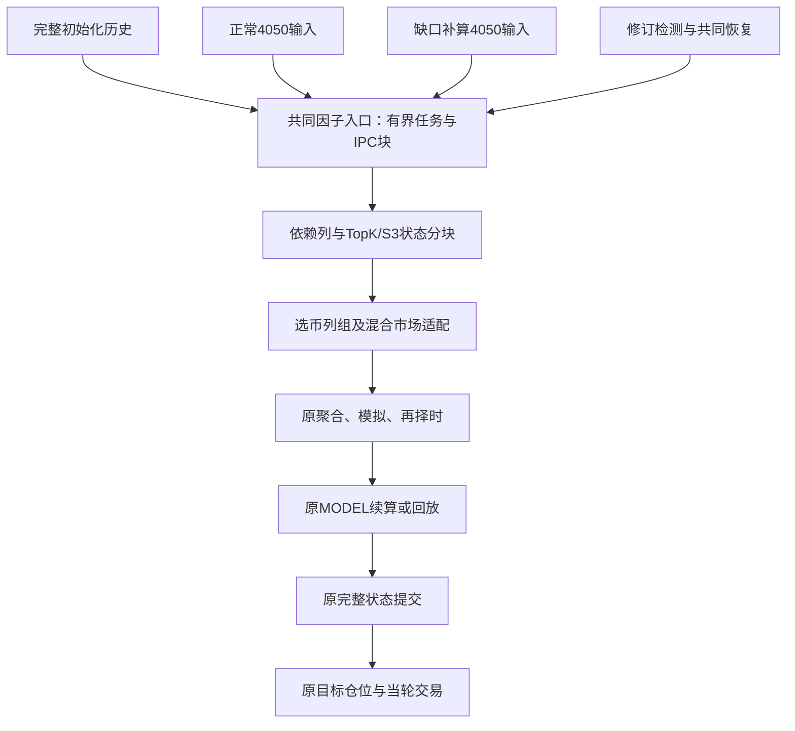

# 共享因子与选币流程：实施及人工复核

状态：代码与本地离线验收完成，人工启用及Ubuntu容量验证未执行。默认 `shared_factor_pipeline=False`；未部署、未启动生产、未下单。Ubuntu 4c8g 容量仍需单独验证。

## 功能与数据边界

初始化、正常4050续算、7小时缺口补算、修订共同恢复后的计算统一调用 `core.backtest.prepare_factor_selection`。正式交易继续消费原格式的目标仓位与状态，不增加历史下单流程。账户参数、S3起点、4050约束、MODEL数学、撤单/补BNB/下单顺序均保持原契约。

- 严格Arrow只向worker发送路径和批次号，不经临时输入PKL；auto/full_pkl仍保留原历史补算、参数分片和回退规则。
- 每币调用原因子函数，按原币种顺序有界收取；输出直接写成时间块×币种分片IPC。保留旧因子的删行/索引行为、参数顺序依赖和共享输入保护。
- 截面只读依赖列。TopK携带每币种/市场前n个实际观察值；S3携带原持仓、排名延迟队列及最终25个恢复点。旧截止以前复用保存输出，不倒退推进状态。
- 纯市场选币按块构建一次窄键排列，每组最多16个策略，读取必要列；完成组后释放宽表，只保留小结果路径。续算先裁剪时间索引，跳过旧块。
- 混合市场有无映射同名现货/合约，不能假定排序键唯一。保留完整历史选择语义：按原条件过滤，只对窄键排序，再逐列gather并释放旧列，避免重排整张宽表。必须比较物理行序，不能只比较集合。
- 原聚合、模拟、再择时、MODEL、目标及订单算法继续使用。普通流程保留每策略选币PKL、报告和现货转合约所需基础价格Parquet，不重复保存整套因子Parquet。状态安装与回放事务不改。

未知截面、自定义选币和entry_exit保留原完整流程，不仅凭存在 `signal_polars` 就假定无副作用。传统 `incremental_lookback_hours` 不禁用；MODEL/S3仍遵守原要求为0的协议。日志中的 `initialization.*` 是共用阶段名称，出现在续算日志不意味着重新初始化或训练。

## 人工复核：本轮15个业务源文件

| 范围 | 文件与变化 |
| --- | --- |
| core，共5个 | `core/utils/factor_data.py`：共同块存储、所有权、投影、窄排序、有界任务；`core/utils/functions.py`：不经过临时PKL的预处理迭代入口；`core/select_coin.py`：可选store、Arrow worker、截面与共享选币；`core/utils/section_state.py`：块输出成功后保存原S3状态；`core/backtest.py`：共同前半程及原回测接线、阶段线程预算 |
| sections，共5个 | `TopKTo2K.py`、`VolumeMaxBias_进出场阈值分离官方.py`：保留原接口并新增受测块状态适配；`动态回撤阈值.py`、`固定回撤阈值触发币数占比开仓门槛.py`、`RankBias.py`：明确共享输入能力 |
| tools，共4个 | `initialization_data.py`：共同存储导入；`initialization_pipeline.py`：新旧入口路由；`robust40/resources.py`：内部阶段Polars预算；`robust40/cli/server_robust40.py`：初始化继承功能开关 |
| 配置，共1个 | `config.py`：默认关闭的通用功能开关，可由机器config.json覆盖，不放accounts |

精确增量：[task-review.diff](../research/shared_compute_20261103/task-review.diff)、[文件清单](../research/shared_compute_20261103/task-review-files.json)。它们相对本轮开始时保存的工作区源码，不是Git HEAD；不能把整个脏工作区diff当成本轮修改。

已逐字节确认 `startup.py`、`core/real_trading.py`、`core/equity.py`、`core/model/backtest_config.py`、`positions/ModelRobust40Strategy.py`、原Arrow reader/datatools相对本轮基线未改。账户、仓管参数与alpha未修改。旧 `tools/streaming_factors.py`、`streaming_selection.py` 恢复为本轮前源码；旧工具FactorBlocks导入保留。

## 开关、并发与回退

| shared_factor_pipeline | INITIALIZATION.data_pipeline | 初始化 | 续算/缺口/回放 |
| --- | --- | --- | --- |
| False | False | 原框架 | 原框架 |
| False | True | 本轮前的初始化工具流程 | 原框架 |
| True | 任意 | 能力检查通过后走共同core | 能力检查通过后走共同core |

因子使用job_num个进程，每进程原生线程1；截面Polars最多2线程；选币1个Python任务、Polars使用job_num预算。共同spawn入口限制OMP/OpenBLAS/MKL/Numba为1，阶段结束或异常后恢复父环境，普通非MODEL策略也适用。不新增账户并行，不改变共享临时目录的串行约束。

关闭shared即可退出本轮新流程，不要求清空snapshot。若同时修改过批次或旧data_pipeline，应恢复它们部署前的值。Linux MemoryHigh4.5GiB/MemoryMax5GiB/SwapMax12GiB保持不变。

## 对拍、审查与环境限制

采用独立oracle或原真实函数，检查空值、并列排名、市场映射、日频、所有分钟偏移、参数顺序、状态恢复和物理行序。完整同源样本1025币种、11,627,074行、89列（88业务列加行号）、43个选币策略、14个组合，8个2016小时块、33个32币分片。

- 完整因子89列值/类型一致，43策略选择结果及物理行序一致，78个snapshot PKL和共同截止一致。MODEL沿用rtol=1e-12/atol=1e-10，其他状态精确比较，没有放宽容差。
- 正常场景连续两轮4050，比较状态、4个目标/mock产物及实际Binance格式化函数的订单参数；固定时钟和账户数据，无网络调用。
- 缺口7小时、有效持仓的Pivot价格修订回放比较状态及2个目标产物。大样本修订是持仓Pivot close修订，并非声称重算了一份全量修订Arrow历史；另有共同恢复/next_close/S3/MODEL的独立完整修订oracle。
- 日界/日频和季度训练复用/修订重训由专项oracle覆盖；没有把固定结束于12:15的性能样本称为季度切换性能实测。
- gpt-6-astra一次独立终审发现初始化开关绕过、next_close验收链缺口及非MODEL原生线程预算问题，全部进入RED/GREEN修复。无延期minor。next_close由原持仓回看窗口更新，保留原恢复边界；未来若成为模型状态定价依赖需扩充契约。
- 缺真实传统账户配置/历史行情的测试明确skip，不计通过。公开fixture不代表缺失的真实5/15/20/25/45账户已验收。既有CciV3上游C/Python差异不在本轮修复；同一Arrow的新旧消费者对拍不能证明所有生产长参数满足4050依赖范围。

## 最终回归结果

2026-11-03，alpha311 Python3.11.11、pandas2.2.3、NumPy2.0.2、Polars1.36.1、PyArrow17.0.0、Numba0.60.0、pytest9.0.3：31个相关文件，**719通过、71跳过、361条既有警告，153.44秒，退出码0**。另一个跨进程1线程/4线程混合重复键专项先单独通过，再包含在本批中，不重复相加。

71项跳过：4项缺真实30m Arrow；1项缺5m-onheart1020公开账户；8项已存5m账户缺匹配2026 spot/swap Pivot；8项缺账户snapshot；5m-onheart0607、15m-nheart0701、20m_heart0723、25m-eart0607、45m_gonheart0607各10项缺账户。未更改数值断言或用新golden替代旧结果。真实C/Arrow与PKL的现有差异和缺数据案例不能由合成测试补成已验收。

完整输出：[最终回归日志](../.superpowers/sdd/2026-11-03-shared-factor-selection/final-regression.log)。根目录新开关及config.json有效值均仍关闭；9个声明不动的入口/内核/旧工具文件已与本轮基线逐字节复核。

## 完整性能口径

基线是本轮前工作区，包含此前17因子的批量接口；初始化两端均启用原有data_pipeline=True、32币批次。正式默认仍是data_pipeline=False、16币批次，不能把32的实测冒充16或未经修改部署默认的收益。其他共同设置为MODEL_JOB_NUM=4、selection_block_hours=2016。

Windows Job约束4个逻辑CPU、8GiB提交量；机器物理内存较大，不等同Ubuntu4c8g的cgroup/换页压力。包含准备、读取、转换、进程创建、计算、保存、退出和清理；续算类另含私有输入发布与证据复制，分项见每轮timing.json。冷Numba单列，未清系统文件缓存；三组不能给可信P95。

最终版本只汇总 `final-init-*`、`final-normal-*`、`final-replay-*`、`final-gap-1`。其他pilot、失败候选和受诊断干扰的运行不混入最终中位数。

10组成对计算及对拍全部通过；冷初始化1组、暖初始化2组、正常续算3组、回放3组、7小时缺口1组。AB/BA交替，以下按同类中位数汇总：

| 场景 | 旧整轮秒 | 新整轮秒 | 减少 | 新进程树提交峰值GiB范围 |
| --- | ---: | ---: | ---: | ---: |
| 冷Numba初始化，1组 | 620.868 | 591.319 | 4.8% | 4.331 |
| 暖初始化，2组 | 576.440 | 535.149 | 7.2% | 4.217–4.372 |
| 连续两轮4050，3组 | 408.482 | 374.443 | 8.3% | 3.744 |
| 修订回放，3组 | 201.474 | 181.180 | 10.1% | 3.758–3.859 |
| 7小时缺口，1组 | 197.259 | 181.201 | 8.1% | 3.747 |

完整初始化旧峰值7.724–7.928GiB，新4.217–4.372GiB；正常续算旧约5.01GiB、新约3.74GiB。单组阶段细分（final-init-3，暖缓存）如下，内存列为2秒采样的进程树private峰值，不是上述Job提交峰值，不能相加：

| 阶段 | 旧秒 | 新秒 | 旧private GiB | 新private GiB |
| --- | ---: | ---: | ---: | ---: |
| 时序因子 | 148.634 | 128.564 | 2.583 | 2.818 |
| 截面 | 67.414 | 66.333 | 5.820 | 4.278 |
| 选币 | 88.936 | 63.546 | 7.362 | 3.246 |
| 14组合聚合及模拟 | 139.499 | 140.109 | 5.236 | 4.050 |
| MODEL | 96.005 | 95.464 | 4.964 | 3.252 |

该组新时序阶段平均使用约3.71核，选币2.55核，截面1.19核，MODEL约1核。整轮CPU时间904.1→974.7秒，墙钟572.3→526.0秒：增加有效并发降低等待，并非总CPU工作量减少。时序峰值略升、截面和选币明显下降，符合分阶段预算目标。聚合/模拟及MODEL没有可归因的内核加速。

证据：[成对完整计时](../research/shared_compute_20261103/paired-measurements.md)、[全部阶段及采样](../research/shared_compute_20261103/measurements.json)。初次汇总脚本遇到早期pilot缺case字段退出；已明确标为legacy-pilot并成功重跑汇总，未重跑或覆盖计算证据，也未把pilot计入最终中位数。

## 没有采用的候选与磁盘成本

- 多Python选币任务未加速：2任务×2线程85.131秒，1任务×4线程62.354秒（早期纯块试验，非最终含混合市场整轮）。采用依赖列组和Polars内部并发，未用更多同时驻留宽表换吞吐。
- 截面4线程峰值接近5GiB，2线程独立阶段76.560秒/4.09GiB、输出8列和S3一致，采用2线程留余量。
- worker直接写因子：完整阶段164.411→142.343秒，但Windows提交峰值2.57→6.42GiB；未引入新行偏移协议。短4050的81列对拍通过，完整候选比较脚本在计算后导入失败，不能声称其全量对拍通过。Windows提交量也不能直接推断Linux会OOM。
- 混合市场最初全宽重排候选整轮峰值7.95GiB，已拒绝。最终窄键/逐列释放后43策略严格一致，独立选币73.393秒、全进程82.576秒、4.037GiB；最终整轮另列，不以阶段数替代。
- 保留的因子块样本322文件/8.819GB，选币334文件/约57.8MB，主snapshot79文件/约1.328GB。这些是阶段产物体积，**不是同时磁盘峰值**，不含.previous、上游输入和swap；本轮未证明总写入字节下降。有效状态及回放文件继续保留，选币后的自有临时因子由原所有权清理。

## 复验与上线边界

离线回归：`alpha311 python -X utf8 -B research/shared_compute_regression.py`，固定31个相关测试文件。性能证据、完整命令和日志在 `research/shared_compute_20261103` 与本计划执行记录。重跑成对性能需新证据目录，不能覆盖既有样本。

人工复核后如要上线，还需单独授权Ubuntu隔离验证：使用同源完整Arrow与本机Numba缓存，同时观察alpha共存时的cgroup anon/file/swap、整轮延迟及失败恢复。不要同步研究目录、基线源码副本、Windows编译缓存或测试snapshot到生产。此文不授权部署、启用开关或删除有效业务数据。
