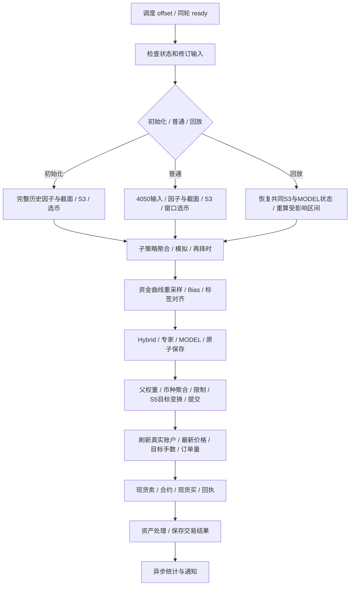

# 全流程性能审计：Bias、模拟、MODEL与执行

审计日期：2026-11-04。用户已接受此前币种差异归因作为阶段验证，将自行把 dry_run 切换为 none。本轮只分析和隔离数值诊断，未修改业务源码、账户、服务或交易模式，未发订单/微信，未重启。按 using-superpowers、systematic-debugging 的证据优先方法执行。

## 结论

仍值得做局部优化，不值得再整体重写后半程。最高确定性的新问题是 **MODEL目标手数执行器在新进程重复编译**，约13秒/轮；其次是正常子策略模拟的重复行情读取、全历史对齐和报告往返。Bias公式和已缓存的Hybrid不是当前瓶颈。MODEL普通小时的纯数值推进很短，优先关注输入/状态搬运，暂不拆季度训练或增加专家并行。

本报告的优化项都是建议，尚未实施；任何收益目标都不是已完成的提速结果。保留此前暂不做 Tail-Only 的范围。

## 1. 证据与口径

- 本地源码：D:/alphaonline，已读 DEVELOPMENT.md 与现有差异；存在大量用户未提交修改，未覆盖。D:/alpha 不是Git仓库，无法提供另一端Git差异证明。
- Ubuntu测试：43.173.122.28，现有 reports/startup.log 中2026-11-04 17:00至22:25普通轮。18个MODEL轮次（5/15/25m），5个传统45m轮次。均使用已有日志；只下载约97KB阶段行，不重新采集行情。
- 18个MODEL记录均为 incremental、status=ok、committed=true，季度训练0。本次样本不覆盖初始化、实际修订回放、跨日/新季度、真实订单成交。
- `INIT_PHASE initialization.*` 是共享计算阶段的旧命名，普通续算也使用，不能按这个名字统计成初始化。
- 下表中位数不满足可相加性；父权重0.802秒包含在3.415秒中。`策略计算总消耗`开始于前置账户处理之后，结束于下单前，不能视为整轮或成交耗时。MODEL_REPLAY total包含其控制器路径，仍不含上游等ready和统计任务等待。
- 不报P95：每类不足20轮。22:15子策略聚合26.39秒为异常慢点，单凭阶段日志不能归因OOM、GC或磁盘压力。

| MODEL阶段 | 中位秒 | 范围秒 | 解释 |
|---|---:|---:|---|
| 修订检查输入读取 | 18.329 | 12.622–23.815 | spot Arrow 8.523、swap Arrow 9.247、Pivot 1.065；分别为中位数 |
| 修订比较 | 0.942 | 0.904–1.380 | 不能为提速取消 |
| 时序因子阶段 | 93.588 | 90.080–120.697 | 包含阶段子进程创建、读取、转换、输出 |
| 截面阶段 | 22.048 | 20.941–27.083 | 共享路径，S3状态保持 |
| 选币 | 2.884 | 2.424–3.886 | 普通续算，不代表初始化全历史 |
| 子策略权重聚合 | 1.637 | 1.568–26.390 | 有一次明显慢轮 |
| 子策略模拟 | 17.737 | 16.197–23.164 | 已多进程，包含IO/状态/报告，不是纯内核耗时 |
| MODEL准备、续算及保存 | 10.666 | 10.196–14.472 | 详见下面拆分 |
| 父权重、聚合、限制、目标变换/提交 | 3.415 | 3.243–3.966 | 包含父权重0.802秒 |
| 目标持仓计算 | 15.011 | 14.872–15.856 | 账户读取、价格、执行器构建/计算 |
| 子策略结束到目标阶段间未单列项等残差 | 2.917 | 2.654–3.826 | 推导值，包括process_equities、文件/日志和订单量计算等，不能称为Bias耗时 |
| 下单前策略计时 | 173.380 | 166.830–244.770 | 不含实际发单 |
| MODEL控制器total | 201.885 | 189.834–276.148 | 与以上嵌套，不重复相加 |

MODEL 10.666秒内部：读状态/配置2.822，行情与子策略输入2.088，历史合并2.204，Hybrid 0.428，专家/MODEL推进1.552，保存1.569。多数时间在状态和输入处理。

传统45m的目标持仓中位1.637秒，模拟14.147秒，聚合22.429秒。不同策略池、仓管、历史范围，不能用它与MODEL直接构造算法A/B提速率。45m聚合值得独立定位，但目前只有5轮。

## 2. 当前实际边界

初始化内部并不完全等于普通路径：`tools/initialization_pipeline.py`已共享market输入，并将子策略结果传给`process_equities(inputs=...)`。普通`core/backtest.py`仍使用独立聚合/模拟进程池，返回equity_list，但`real_trading`随后`process_equities`从CSV及snapshot重新读取。不能把普通路径发现的重复IO再次套到已优化的初始化路径。

## 3. 首要发现：执行器的首次编译

代码：`positions/ModelRobust40Strategy.py:1156 LiveRebRobust40` → `RebRobust40 @jitclass` → `calc_lots`；由`core/position.py:82`创建。每个账户worker是新进程。这与已有Hybrid磁盘缓存、MODEL `start_simulation(cache=True)`属于不同调用入口。

用现行真实类和合成3现货/126合约输入做隔离探针，不导入账户、不执行下单；socket连接被审计钩子禁止，缓存只写独立research目录。每个平台连续启动两个新进程，复用同一探针缓存目录。

| 环境/进程 | 构建秒 | 首次calc秒 | 首次CPU秒 | 同进程第二次calc |
|---|---:|---:|---:|---:|
| Windows 1 | 1.587 | 13.743 | 13.609 | 0.310ms |
| Windows 2 | 0.926 | 13.618 | 13.609 | 0.927ms |
| Ubuntu 1 | 0.993 | 12.953 | 12.911 | 0.334ms |
| Ubuntu 2 | 0.691 | 13.076 | 13.056 | 0.319ms |

结果一致：spot=[2000,2000,2000]、swap手数和=-63000。这个小样本是性能定位，不是所有交易边界的正确性验收。Ubuntu低优先级单进程，现场可用内存约6.6GiB，磁盘31GiB；探针不作为整轮性能基准。

**判断：当前执行入口不能跨新进程有效复用首次编译，解释了约15秒目标计算的大部分。** 配置NUMBA_CACHE_DIR本身不能解决。官方Numba将jitclass方法编译为nopython函数，但函数磁盘缓存有独立约束，不能把“模拟器已缓存”等同于“Python直接调用jitclass已缓存”。

建议首个小改动仅聚焦该模块：抽出数组/标量输入的纯数值函数，比较可缓存`njit(cache=True)`与原生NumPy路径；保留薄Python适配器。优先共享同一数学实现，不制造模拟与真实执行两套公式。首次安装仍可能编译，但以后新worker应真正命中缓存。必须新进程测试；同进程第二次快不算成功。

收益量级有实证约13秒可研究，约为当前控制器201.9秒的6%；这不是已实现节省。无需为此改accounts、startup或保持常驻账户进程。

验收重点：0.4死区边界、2.45执行上限、纯多头预算、整手截断、开/清/反向仓、空数组、最小金额、无效活跃价格、非连续数组、不同币种数、真实单位及正负权重；固定输入下目标手数严格相等。参数通过函数显式传入，避免Numba缓存将全局参数固化。缓存的跨文件依赖失效也需考虑，不能只测热进程。

## 4. Bias：公式很便宜，外围IO更值得整理

`factors/Bias.py`实际公式是`(close / rolling_mean(n)).pct_change(n)`，并非普通`close / ma - 1`。不能只保留n根去续算：还有n期差分依赖及NaN/填充语义。

14子策略×14050行×[48,144,216]合成数据，本地纯公式中位0.0479秒，输出42列。此测试不含真实资金曲线读盘、重采样和对齐，只用于判断公式优化的量级。

`core/model/backtest_config.py:764 process_equities`还承担：读取14条完整CSV、hold_period重采样、计算因子、ffill/dropna、读取28个spot/swap历史持仓矩阵、统一时间轴及写equity_df。当前普通链路刚模拟完已有资金曲线，却又写CSV再读。

可以后续利用现有`inputs=`接口内存交接，继续保留现有报告输出；测量净收益必须包含进程结果序列化和保留内存。不要新增进程池只为了0.05秒Bias，也不要给Bias再做一套C实现。

虽然轮动仅使用部分子策略，其他策略因子仍可能影响dropna后的共同起点、统计和其他仓管消费者，不能直接停止12条资金曲线的Bias计算。1H、4H等重采样、分钟offset、首尾未完整K线的裁剪必须保留。

## 5. 子策略模拟：值得小范围去重，不宜直接增加并发

`core/backtest.py:422`已经有模拟进程池。17.7秒不是14个纯串行模拟等待，不能再承诺简单增加4线程就减半。

静态可确认的重复：

1. `core/equity.py:118`每次默认读spot/swap完整Pivot；`core/utils/datatools.py:68`逐年PKL反序列化、concat并排序，无轮内复用。
2. 当前14组合、其中2个再择时，正常完整调用路径约16次calc_equity，即32次市场侧读取调用。实际物理读盘还受页缓存影响，不能把次数乘单次耗时当收益。
3. `merge_state`先按币种对完整行情reindex，之后才走模拟区间裁剪。续算内核只推进少量小时，但外围可能处理长历史。
4. 再择时读回刚写的account_state0，再次模拟是必要数学步骤；其重复读取/对齐不一定必要。
5. snapshot历史权重、资金曲线及CSV仍全量拼接/写出；子进程返回的资金曲线随后也被重读。

建议次序：先加少量阶段计时区分read/align/kernel/save，再在**同轮不可变行情**边界复用worker内市场输入，使用已有`market_inputs`接口；考虑一个worker顺序处理几个组合。不要主进程把完整大表序列化发14次，也不要全局无限缓存跨轮行情。

每组合可只对齐需要的时间/币种，但必须保留恢复起点、上期价格、未平历史币种、退市列与手续费/资金费率。`merge_state`会改字典条目，共享数据要保留只读所有权及独立字典外壳，不能共享可变对齐结果。

涉及范围预计`core/backtest.py`与`core/equity.py`调用/输入边界；若需要公共读取接口再涉及datatools。不是替换模拟数学。初始化现有market共享方案可参考，不能把它又改回每组合读取。

Linux进程边界也需检查：共享因子阶段已明确spawn，而后续聚合/模拟池使用默认上下文。父进程已有Polars参与时，应按Polars官方说明核对spawn；不能为少几秒启动成本盲目fork复用多线程状态。本轮未复现死锁，也未改启动方式。

## 6. MODEL状态、初始化与回放的不同优先级

普通小时：Hybrid仅0.428秒、专家/MODEL推进1.552秒。重新训练并未发生。输入整理、状态读取、合并、原子保存合计占大头。可减少重复DataFrame构造、只对新增时间做必要对齐；目前每段1–3秒，改状态分片协议的成本较高。

`advance`还会重建历史日级风险/收益、周级分配表，理论上可按日缓存，但缓存失效需覆盖修订与季度边界。普通纯数值总成本仅1.55秒，暂不优先。

初始化：`calculate`需要完整专家账户历史和模型，普通小时计时不能外推。历史报告中初始化MODEL曾108–157秒，但期间已经有日期转换优化，不能把旧值当当前最终版。下一次确有初始化时再拆raw-read/features/experts/train/save；不为获取这个指标清空有效snapshot。并行专家会复制行情、账户矩阵和检查点，4c8g先算总创建/序列化/换页成本，不能只计内核。

修订回放：必须恢复S3、子策略和MODEL的共同点。当前自然样本未触发回放，不能按普通1小时1.55秒估算多日回放。先保留既有通过的同源回放测试；若改变共享模拟输入或状态缓存，追加相应修订场景对拍。

修订检查仍有18.329秒输入读取，其中Pivot只约1秒。下一步如继续前半程优化，应针对Arrow窗口读取、列投影和转换，不能再预估“按年份过滤Pivot省10秒”。也不能不查历史修订来省时间。

## 7. 真正下单及统计：性能边界和必要观测

真实交易除计算外还包括账户设置/补BNB、撤单、现货卖→合约→现货买、TWAP、GTC/IOC处理与重试、资金归集/基础保证金调整。dry_run没有覆盖这些外部操作，已有阶段验证不等于这些调用的性能已验收。

可审查但尚不能直接删的项：

- `calc_target_position`重新读账户：计算前那次账户快照已隔数分钟，保留临近下单刷新合理。
- 目标计算读取spot/swap ticker，`calc_order_amount`又读取两侧ticker；`BaseClient.get_*_ticker_price_series`每次实际调用fetch，不是单纯读取属性。这是明确的重复请求候选，但当前中间有13秒编译，第二次价格更“新”，不能直接删。先解决编译，再评估同一执行快照传入及拆单金额语义，实际报价仍按原执行规则。
- 现货买阶段固定sleep(5)、每batch TWAP后sleep，以及collect_asset多处调用：分别涉及结算/资金可用性、拆单节奏和账户类型。可先统计有无买单/调用结果，不能把所有等待都视为无用。
- 当前业务取了spot/swap最终失败列表但没有在real_trading统一落成整轮执行结果；底层可能已有失败日志。真实测试应关联最终失败/回执与订单表，不能把“计算已提交”当“全部成交”。这是观测完整性问题，不建议本轮加新的生产保护门禁。
- `calc_order_amount`持仓清仓、建仓、减仓、反向调仓及缺报价处理属于交易行为；性能修改不能顺便改变。

仅推荐利用既有日志补必要计时：账户刷新、ticker、执行器构建/首次调用、各批请求/重试/TWAP等待、回执数量、最终失败数量、资产处理、结果落盘。记录账户/offset/stamp和耗时即可，不采集密钥、签名URL、全行情或重复整套snapshot。

统计在主流程结束后异步执行，另有约120秒等待；它不应计入订单前延迟。已有只读overview共享、并发上限与忙账户跳过，继续保留。它可能与下一offset争CPU/IO，但应从实际时间重叠判断。旧历史订单抓取函数虽存在，不能因为里面有sleep就断言当前run调用了它。`save_final_select_results`使用各组合最新持仓周期结果，保留72份账户文件；不是每小时复制整个因子历史。

## 8. GC与优先级

现有局部第0代GC已处理过实际慢点：DEVELOPMENT记录初始化全代GC约13.127秒降到局部0.0023秒；该结果属于前次验证，不能再次计算本轮新增收益。未见证据表明这次约13秒执行耗时是GC，探针CPU和首次/重复调用特征指向JIT。

不建议全局禁用GC、删除所有gc.collect或恢复强制频繁进程回收。当前`startup`轮末GC与选币旧分支GC是否值得调整，应先有该路径的gc暂停记录；NumPy/Arrow所有权和Windows映射释放仍必须可靠。

| 优先级 | 建议 | 收益证据与代价 | 场景 |
|---|---|---|---|
| 1 | 消除LiveRebRobust40每worker重复编译 | Ubuntu两进程约13秒；小范围但订单数学须严格对拍 | dry_run/真实目标手数，可能间接共享模拟 |
| 2 | 模拟同轮行情复用、先裁时间后对齐 | 阶段17.7秒，重复读取确定；具体可省量尚未拆分 | 普通、回放；初始化已部分具备 |
| 2 | 真实订单分段统计 | dry_run没有成交阶段数据；决定等待/接口是否值得改 | none真实下单 |
| 3 | 资金曲线及再择时内存交接 | 已有inputs接口，外围残差约3秒但不可全算收益 | 普通/回放；传统回归 |
| 3 | Arrow修订读取继续窄化 | 每轮18.3秒，以Arrow为主 | 普通/回放检查 |
| 观察 | 传统45m聚合22秒、MODEL聚合偶发26秒 | 需分读盘/计算/换页，不能先换v2算法 | 传统及慢轮 |
| 低 | MODEL状态分片、日级缓存、专家并行 | 普通数值只有1.55秒，协议/回放风险高 | 大历史初始化另测 |
| 不推进 | 重写Bias、重写Hybrid、Tail-Only、数据库替代状态 | 当前收益低或超本轮既定范围 | 保留 |

后续若实施：一次只做一个候选，先独立oracle/TDD，固定资金/价格/手数/权重严格一致；计时包含新进程启动、编译、读写和释放。模拟共享输入需分别验证初始化、正常小时、跨日、缺口、修订回放和传统45m，并覆盖非整点offset/其他hold_period。无需重新大范围收集行情，优先用现有冻结证据与合成边界。

## 9. 可复核产物与官方资料

本目录：`stage-log.txt`、`parse_stages.py`、`stage-audit.json`；`probe_execution_jit.py`及Windows first/second、Ubuntu first/second四份JSON；`probe_bias.py`/JSON。服务器仅新增research/live25_20261104/post-selection-audit离线脚本及其缓存，无业务改动。

- [Numba 0.60 jitclass](https://numba.readthedocs.io/en/0.60.0/user/jitclass.html)：方法编译语义。
- [Numba 0.60 caching](https://numba.readthedocs.io/en/0.60.0/developer/caching.html)：函数缓存、全局常量和跨文件失效限制。参数应显式输入，需新进程验证。
- [Polars multiprocessing](https://docs.pola.rs/user-guide/misc/multiprocessing/)：内置线程与spawn/fork边界。增加进程不天然提高吞吐。

本轮没有验证优化后的收益，也没有声称真实成交已经通过。用户已接受阶段对比，实际模式切换仍由用户手工完成。
