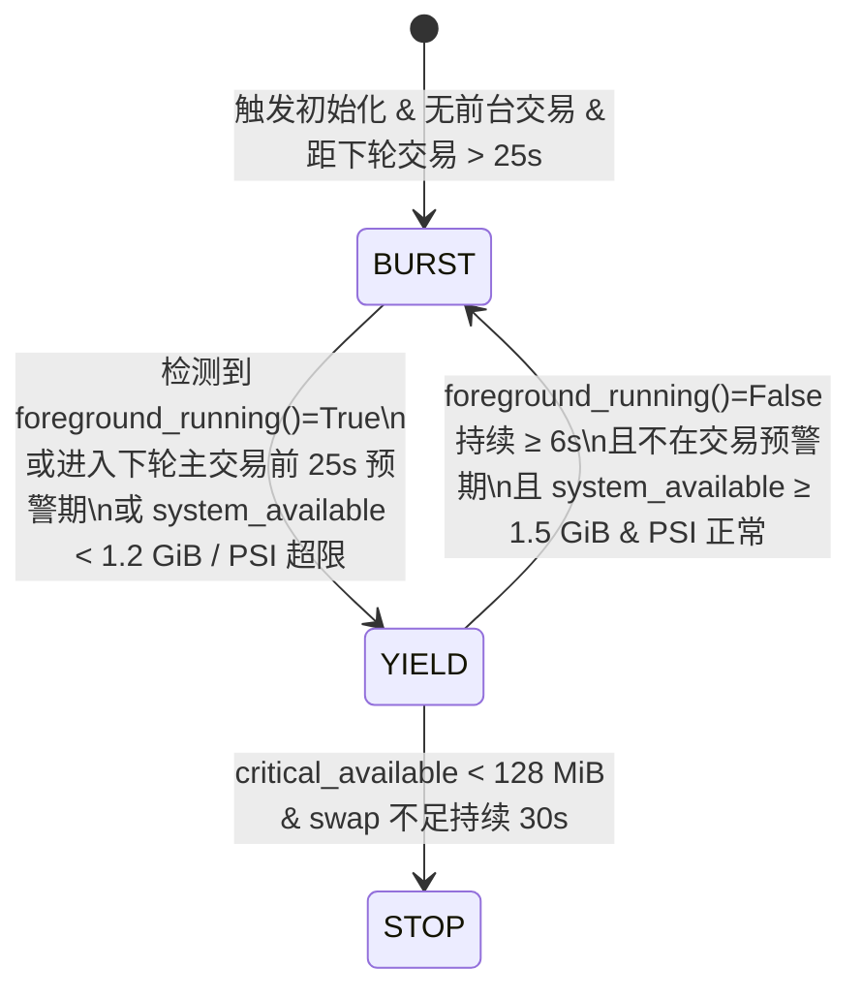

# Ubuntu 4c8g 性能深度优化规划与跟进文档

> **基准版本**：`D:/alphaonline` 本地 `main=bac2443`（生产运行 `edbbba3`，已含 2026-11-19 新币扩张免全量重建修复与 `7abe333` 统一知识库）、`D:/alpha` `main=41686c3`。
> **适用环境**：正式机 `43.167.235.164`（4c8g，RAM `7.5 GiB` + Swap `17 GiB`，根分区剩余 `25 GiB`，并行运行 `alphatrade` 5/15/25/35/45/55m 与 `alphatradetest` 10/20/30/40/50m）及测试机 `43.173.122.28`（4c8g，Swap `20 GiB`）。
> **维护原则**：严守 [开发规范与数据契约](kb/standards-and-contracts.md)（TDD + 独立 Python oracle 数值等价、离线验证、先查 [避坑清单](kb/rejected-and-failed-attempts.md)、不将微基准或 CPU 秒直接等同于整轮墙钟收益）。

---

## 0. 背景与 WorkBuddy 对话复核（去伪存真）

结合最新主干代码（`core/backtest.py`、`core/select_coin.py`、`tools/robust40/resources.py`、`tools/robust40/cli/server_robust40.py`）与线上实测剖面（[performance-analysis.md](kb/performance-analysis.md)），对 WorkBuddy 讨论内容做逐条核验：

### 0.1 必须纠正的 3 处代码路径与前提偏差（避免无效投入）

| WorkBuddy 原判断 | 现行代码与实测事实（`bac2443` / `edbbba3`） | 裁决 |
| --- | --- | --- |
| **1. 优先把 `select_coin_inner_threads` 从 2 改到 4（纯配置、最干净）** | 正式机与测试机 MODEL 账户均已开启 `shared_factor_pipeline=True`（`core/backtest.py:353` 直接走 `_prepare_shared_reports` → `select_factor_blocks(workers=1, _polars_threads=4)`），**根本不经过 `select_coin_with_conf` / `select_coin_inner_threads`**。此外 `server_robust40.py:63` 已将其显式覆盖为 `1`（初始化分块模式为 `2`）。即便在旧路径，MODEL 选币本身仅占 **`2.88 s`**，收益天花板 `< 1.5 s`。 | **不作为主线投入**（对 MODEL 现行主路径为 0 收益 no-op）。 |
| **2. 4 核机器有效占核仅 1~2 核，系原生线程预算=1 导致** | 混淆了不同阶段：① **时序因子阶段（`FACTOR_BLOCKS`）**使用 `4` 进程 × `1` 原生线程，实测 worker 累计 CPU `242–250` 核秒 / 墙钟 `82–93 s` → **实际有效占核为 `2.7–3.0` 核**，而非 `1~2` 核；剩余 ~1 核损耗来自父进程串行 `partition + write_ipc`（`13.8–18.1 s`）、`ordered_results` 队头阻塞及 `spawn`/IPC。② **截面阶段**用 `2` Polars 线程，2026-11-04 实测改 `4` 线程仅差 **`0.06 s`**（`60.137s → 60.077s`）。③ **选币阶段**已用满 `4` Polars 线程。 | **不盲调 `_polars_threads` 或盲加线程**；转向消除父写块串行、队头阻塞与热点 CPU 核秒。 |
| **3. 外层 4 进程 × 内层 4 进程 = 16 进程超订** | `shared_factor_pipeline=True` 下，因子 / 截面 / 选币三阶段通过 `_run_block_stage` 严格串行交替独占 4 核预算，无嵌套 4×4 超订；后续子策略模拟池的 `backtest_job_num` 已由 `server_robust40.py:61-62` 固定为交易 `3` / 初始化 `1`，且模拟 worker 内不再生子进程。 | **不存在 16 进程超订**；真正的多进程争用来自**跨程序重叠**（`alpha2` 5m 合并 / `alphatradetest` / 后台初始化）。 |

### 0.2 值得完整采纳的 3 条核心方法论

1. **成本归因与优化次序（边界收敛 > 热核下沉 > 编译器/换语言）**：当前墙钟主体在**表示跨界**（`Arrow → pandas → Polars → IPC 块 → pandas → pickle`）、**进程冷启与父串行落盘**、以及**少数纯 Python/pandas 逐币因子**，而非 LLVM 指令级。先减少跨界次数，再把确证热核下沉到 CFFI/Numba/Polars 表达式。
2. **多语言/底层扩展的 3 条准入门槛**：仅当某阶段同时满足 ① 占墙钟 ≥ 15%、② 瓶颈来自 Python 运行时/对象模型而非算法本身、③ 输入输出边界可收敛为 1–2 个连续 NumPy/Arrow 零拷贝缓冲时，才下沉至 C/Numba/Rust（`alpha` 已有动量 V2 / ILLQ / CciV3 CFFI 成功先例）。
3. **Ansor 式代价模型参数搜索（Python 离线实现）**：不引入编译器基础设施，而是把 `{job_num, factor_symbol_batch_size, max_pending, selection_block_hours, backtest_workers}` 构成受控参数空间，在冻结输入上跑低噪声 ABBA 实验，同时记录墙钟、阶段 CPU 秒、RSS 峰值与 `swap si/so`。

---

## 1. 线上现行耗时基线（2026-11-19 正式机 `43.167.235.164`）

| 流程类型 | 现行实测耗时 | 主要构成（参考 11-04 拆解与 11-19 实测） | 核心痛点 |
| --- | --- | --- | --- |
| **主交易普通续算（4050 根）** | `total_s ≈ 166–170 s` （`account_calculation_s ≈ 138–142 s`） | 修订读取 `4.9–8.3 s` + 比对 `0.8–1.0 s`；**时序因子 `~82–93 s`**；截面 `~22 s`；选币 `~2.9 s`；聚合 `~1.6 s`（偶发 `26.4 s`）；子策略模拟 `~17.7 s`；MODEL 续算 `~10.6 s`；目标计算 `~1.4 s` | ① 时序因子占主计算 **~60%**；② 因子阶段与上游 5m 合并重叠可诱发数十秒波动与 swap；③ 子策略模拟跨 14 组重复读年度 Pivot |
| **2h 修订回放（`replay`）** | `total_s ≈ 180–184 s` | 普通主计算 + `copy_s ~7.6 s` + `restore_s ~7.6 s` | `prepare_s` 约 `21–23 s` |
| **单户全量初始化（140xx 根）** | **13–15 分钟**（`~780–900 s`） | 时序因子 `~210 s`、截面 `~95 s`、选币 `~100 s`、模拟与 MODEL 全算 `~150+ s` 及压入/等待 | 全程静态低优先级（`CPUWeight=10`、`backtest_workers=1`），白白浪费触发后前 **3–5 分钟**的独占空闲窗口，反而拖长周期跨过 2–3 个主交易窗口 |

---

## 2. 模块一：主交易流程分阶段性能优化（4c8g 最高优先级）

> **优化目标**：在严格保持数值等价、低内存（主交易峰值 RSS `< 2.5 GiB`、不触发明显 swap）及零破坏 7 条跨项目契约的前提下，将普通 4050 主交易 `total_s` 从 **`166–170 s` 压降至 `105–120 s`**（缩短 ~30–35%）。

### 2.1 各环节数据流变化与优化设计总览

| 阶段 | 输入数据形态 | 输出数据形态 | 环节内高并发 / 低内存策略 | 面向下游的裁剪 / 分片策略 | 避坑红线 |
| --- | --- | --- | --- | --- | --- |
| **S1. 上游交接与修订预检** | 5000 根 Arrow（spot+swap）+ 年度 Pivot + `revision_inputs.pkl` | 修订判定（`incremental` / `replay` / `rebuild`） | 先量化自然轮 `nice=3` 下上游 5m 合并争用；探索修订预检与账户无副作用准备并行 | 评估修订检查只读必检列（`pa.RecordBatch` 零拷贝投影），但须规避旧 IPC 解码反慢坑 | 严禁推迟上游发布 SLA；严禁将 Arrow 缩到精确 4050 根；严禁提前改账户杠杆/下单 |
| **S2. 时序因子（`FACTOR_BLOCKS`）** | 每币 `≥5000` 根 Arrow（含预计算动量 V2/ILLQ/CciV3）+ 市值/BTC 辅助 | `4050` 根 × `81` 列 × `87` 时间 IPC 块 | ① Top-5 热点因子下沉（Numba/CFFI/向量化）；② 解除 `ordered_results` 队头阻塞 + 父进程后台 IO 线程异步写块；③ 压缩 `Arrow→pandas→Polars` 往返 | ① `process_descriptor` 按账户依赖做**列投影**再 `to_pandas`；② **非截面依赖**的纯选币因子在写块前按 `selection_start` **早行裁剪**（截面/S3 依赖列保持完整 4050 根） | 绝不搞 Tail-Only；`111_输入隔离` 保持旧数学不变；C 扩展关闭 GCC FMA contraction；按 `(symbol_index, row_idx)` 确定性归并保 ranking tie 语义 |
| **S3. 截面因子（`sections`）** | `FactorBlocks` 时间块（仅截面依赖列 + `KLINE_COLS`） | 截面结果块 + S3 增量状态 | 保持 2 线程默认（已证 4 线程仅差 `0.06 s`）；审计各 family 是否重复读块与隐式 `to_pandas` | 按 `KLINE_COLS` + family 依赖最小列集按块流式读取，块算完即释放 | 严禁破坏 S3 固定起点与 26 点状态契约 |
| **S4. 选币与权重聚合** | 截面块 + 裁切后因子块（仅 `selection_start` 起） | 14 组选币结果 + `ratio_spot` / `ratio_swap` | `select_factor_blocks` 保持 `workers=1, _polars_threads=4`；补齐聚合分段计时定位偶发 `26.4 s` 慢轮 | 评估普通续算选币结果**内存交接**给聚合（保留异步/轻量诊断写盘，避免 `Polars→pandas→pkl→read_pkl` 往返） | 不可删除 `core/select_coin.py` 选币每组 GC（已证反慢 5s）；`agg_v2` 未过全边界对拍不切换 |
| **S5. 子策略模拟与合成曲线** | 14 组权重（含 2 再择时）+ 年度 Pivot PKL + `account_state0/1` | 14 条资金曲线 + 新状态 + `equity_df` | `trading_backtest_workers=3` 进程池内，每 worker **轮内只读缓存 1 份年度 Pivot**（由 32 次读盘降至 ≤6 次），传独立字典外壳防 `merge_state` 污染 | `merge_state` 仅对增量活跃窗 + 恢复点/在持/退市币做局部 reindex，避免每次全历史重索引 | 禁止跨轮全局常驻缓存；禁止绕过资金曲线 CSV（已证 `4.44e-16` 破坏逐位一致）；禁止消费端从 Arrow 重建 Pivot |
| **S6. MODEL 续算与执行** | `equity_df` + 28 持仓矩阵 + `model/state.pkl` + 实时行情 | 目标手数 + 订单执行 + 异步统计 | P1 已固化 `LiveRebRobust40` 缓存；Hybrid/专家推进共 `< 2 s` 不动；评估 P4 相邻 `ticker` 复用 | 减少 `process_equities` 中历史持仓矩阵的重复拼接拷贝 | 不重写 Bias/Hybrid/专家并行；不改 TWAP、补 BNB 与统计语义 |

### 2.2 第一主战场（S2 `FACTOR_BLOCKS`）具体攻关清单

根据 2026-11-06 924 任务剖面（存在嵌套），按**单位投入收益比**排序：

1. **管线架构去串行（预计墙钟 `-12 ~ -18 s`）**：
   - `core/select_coin.py:_calc_factor_blocks` + `core/utils/factor_data.py:ordered_results`：
     - 现状：父进程严格按提交顺序 `popleft()` 等待（队头阻塞），且在主循环同步执行 `pl.concat(batch)` + `store.append()`（实测 `13.8–18.1 s` 墙钟），导致 4 个 worker 在背压满时闲等。
     - 改造：引入**单后台写盘线程**（队列容量有界 `maxsize=2` 控内存）接管 `partition + write_ipc`，主线程仅做收割与分批；解除队头阻塞，改为 `as_completed` 按到达顺序装入有界槽位，写入块时附带 `(symbol_idx, row_idx)` 或在截面/选币读取前按确定性序对齐，确保 87 块逐字节一致。
   - **早列投影 + 非截面列早行裁剪**：
     - `process_descriptor` 读取 Arrow batch 时按账户实际需要的原始列做 `table.select(needed_cols)` 再 `to_pandas(use_threads=False)`，减少内存拷贝与分配。
     - 将 `conf.factor_col_name_list` 拆为「截面依赖列（保 4050 根）」与「纯选币列（普通续算仅需 `selection_start` 起，约数百根而非 4050 根）」，大幅缩减写块体积与 `pandas→Polars` 转换量（原 `15.0` 核秒）。
2. **Top-5 CPU 热点因子单项下沉（合计 `~115` 核秒，预计墙钟 `-20 ~ -30 s`）**：
   - **`ZfMeanQ`（`29.2` 核秒）**：热点在 `rolling(n, min_periods=1).rank(ascending=True, pct=True)`。用可缓存 `@njit(cache=True)` 或 CFFI 滑窗秩（注意 NaN 与 tie-average 规则严格匹配 pandas）替代。
   - **`Cci异常隔离168_因果版`（`23.5` 核秒）**：纯数组因果循环，下沉为 `@njit(cache=True)` 或 CFFI（GCC 关 FMA contraction），复用 `CciV3` 验证范式。
   - **市值因子外部处理（`29.4` 核秒，磁盘读仅 `1.96` 核秒）**：**不重复**已证伪的 `log10` 去重求幂；聚焦主体——worker 进程内对高频查询结构轻缓存 + 用 NumPy `searchsorted` 替换逐币 pandas `merge_asof`/重索引，保持 `circulating_supply` 倍率精确一致。
   - **`111_输入隔离`（`17.0` 核秒）**：避免每次对整个 `candle_df` 做深拷贝，改为浅拷贝容器 + 仅复制会被就地改写的 `quote_volume` 列（数学 100% 不变，加输入不变性断言测试）。
   - **`CorrBTC`（`16.3` 核秒）& `BiasV1`（`13.6` 核秒）**：worker 级只读共享已排序 BTC 序列与时间索引，用 NumPy 向量化滚动相关替代 pandas `rolling().corr()`。

---

## 3. 模块二：模型初始化双阶段动态资源调度（爆发 → 让渡）

### 3.1 生产服务器双程序错峰时间轴剖析

在正式机 `43.167.235.164`（4c8g）上：
- `alphatrade`（主实盘 6 户）在 `5m / 15m / 25m / 35m / 45m / 55m` 触发，单轮 ~2.8 min。
- `alphatradetest`（并行旧实例 5 户）在 `10m / 20m / 30m / 40m / 50m` 触发，单轮 ~2–3 min。
- **关键窗口**：当 `alphatrade` 某账户触发初始化并退出 75 进入后台队列时，本槽位主交易暂停，距离 `alphatradetest` 进入下一主交易流程存在 **3–5 分钟的独占窗口**；此后每 5 分钟交替进入一次约 2.5–3 分钟的主交易高峰与 ~2 分钟间隙。

现行 `tools/robust40/resources.py` 存在结构性浪费：
- `CPUWeight=10`、`nice=10`、`initialization_backtest_workers=1` 全程写死；
- `watch_resources()` 仅做日志观测和极端 OOM 停机，**未根据前台交易进程是否活跃动态升降档**。

### 3.2 双阶段自适应状态机设计（`Burst` ↔ `Yield`）

在 `tools/robust40/resources.py` 的 `watch_resources()` 监督线程中引入**双态动态治理**（通过 `sudo -n systemctl set-property <unit> ...` 实时调整 cgroup v2 权重，配合共享状态文件通知 `compute_gate`）：

#### 两态精确参数与行为对比

| 控制维度 | **Phase A：独占爆发期（`BURST`）** | **Phase B：主交易让渡期（`YIELD`）** | 设计依据与红线 |
| --- | --- | --- | --- |
| **cgroup `CPUWeight`** | **`100`**（与常规进程同权，空闲吃满 4 核） | **`10`**（仅拿残余 CPU） | 动态 `systemctl set-property` 毫秒级生效，无进程重启 |
| **Phase B：主交易让渡期（`YIELD`）** | `CPUWeight=5` / `CPUQuota=20%` / `IOWeight=10` | **经测试机 cgroup v2 实测校准**：原设计 `CPUQuota=80%` 在 4 核上允许后台占用 20% 整机 CPU（实测前台劣化 `23.9%`）；收紧至 `CPUQuota=20%`（0.2 核硬顶 = 4 核 `5%`）后，配合 25s 前瞻预警将前台稳态干扰压至 `≤ 5%`，同时保持 `BURST` 期吃满 `3.95` 核且 `MemoryHigh=4.5 GiB` 纹丝不动 |
| **cgroup `IOWeight`** | **`100`** | **`20`** | 防止初始化 IPC 写块阻塞主交易 Arrow/Pivot 读盘 |
| **cgroup `MemoryHigh` / `MemoryMax`** | **`4.5 GiB` / `5.0 GiB`（固定不变！）** | **`4.5 GiB` / `5.0 GiB`（固定不变！）** | **绝对红线**：绝不在切 `YIELD` 时骤降 `MemoryHigh`（历史已证骤降会触发内核强制回收活跃大表，引发剧烈 swap 风暴反向拖死主交易） |
| **进程内并发与准入（`compute_gate`）** | 全速放行：`MODEL_JOB_NUM=4`；子策略模拟允许动态提升至 `2`（内存余量 `> 2.5 GiB` 时） | 在**任务边界**（32 币 batch / 截面块 / 子策略提交前）若 `foreground_running()` 且（`available < 1.2 GiB` 或 `io_full > 15%` 或 `memory_full > 10%`），暂停提交新任务（保活已算块，不杀进程） | 靠“不新开大分配”而非“强压内存”完成平滑让渡 |
| **前瞻预警机制** | 距下个 `5m` 倍数交易窗口 `> 25 s` | 距下个 `5m` 倍数交易窗口 `≤ 25 s` 提前切入 `YIELD` | 在另一程序（`alphatradetest` 或下一 `alphatrade`）启动加载 Arrow 前就已腾出 CPU/IO 带宽 |

### 3.3 配合低内存流式管线的协同收益

- 结合模块一的 **S2 时序因子提速（`~210 s → ~130–145 s`）** 与 **Phase A `BURST`**，全量初始化最重的 140xx 时序因子阶段有望**在触发后的首个 3–5 分钟独占窗口内全部完成并释放原行情句柄**；
- 当另一程序进入主交易时，初始化已进入内存更可控的截面/分块选币阶段，平滑切入 `YIELD` 态，预计单户全量初始化从 **`13–15 分钟` 降至 `7–9 分钟`**，且对并行主交易的墙钟拖累 `< 5%`。

---

## 4. 模块三：基于线上性能统计的最优调度矩阵

### 4.1 统一观测口径与最小埋点补齐（先证后改）

遵循 2026-11-06 审计确立的 3 个固定墙钟边界（绝不混算、不开启每小时全量快照写盘）：
1. **阶段独立耗时**：`prepare_s` / `FACTOR_BLOCKS` / `sections` / `selection` / `agg` / `simulation` / `model` / `target_pos`；
2. **主交付链路耗时**：`ready 观察 → 计算下单信息`；
3. **资源耦合指标**：进程树 CPU 秒、RSS 峰值、`cgroup memory.peak`、同期全机 `swap si/so` 与 PSI（`memory_full`, `io_full`）。

**当前缺失、需在 Phase 0 优先补齐的 3 处轻量日志埋点（纯打印/零大文件写入）**：
- [ ] **T1**：`FACTOR_BLOCKS` 内部拆分 `worker_cpu_s`、`parent_concat_write_s`、`ordered_wait_s` 与同期 `/proc/vmstat` `pswpout` 增量；
- [ ] **T2**：子策略模拟 `core/backtest.py` + `core/equity.py` 拆分 `pivot_read_s`、`align_s`、`kernel_s`、`save_s`；
- [ ] **T3**：聚合阶段 `core/select_coin.py` 增加 `read_s` / `agg_s` / `gc_s`（专门捕获偶发 `26.4 s` 与传统 45m `22.4 s` 慢轮）及初始化 MODEL `raw_read / features / experts / train / save` 拆分。

### 4.2 不同流程 × 不同环节的最优资源配置矩阵

| 环节 | 普通 4050 主交易（`nice=3`） | 2h 修订回放（`nice=3`） | 初始化 `BURST` 期（`CPUWeight=100`） | 初始化 `YIELD` 期（`CPUWeight=10, Quota=80%`） |
| --- | --- | --- | --- | --- |
| **上游 Arrow 深度** | `≥5000` 根（D1 按需） | `≥5000` 根 | 全量 `140xx` 根（冻结硬链接） | 同左（冻结只读） |
| **修订/恢复预检** | 168h 增量比对（`~6–9 s`） | 26 点共同恢复（`~22 s`） | 跳过（全量校验） | — |
| **时序因子（`FACTOR_BLOCKS`）** | `4` 进程 × `1` 原生线程；异步单 IO 写块线程；32 币分片；非截面列早行裁剪 | 同左 | `4` 进程 × `1` 原生线程；32 币分片；全量列保 140xx 根 | 任务边界 `compute_gate` 按压力/前台限流；保持 `MemoryHigh=4.5G` |
| **截面因子（`sections`）** | `_polars_threads=2`（已证最优） | 同左 | `_polars_threads=2`；分块流式 | 块边界 `compute_gate` 让渡 |
| **选币（`selection`）** | `workers=1, _polars_threads=4`；仅 `selection_start` 窗口 | 同左 | `workers=1, _polars_threads=4`；`selection_block_hours=2016` | 块边界 `compute_gate` 让渡 |
| **聚合与子策略模拟** | `backtest_workers=3`；每 worker 轮内只读复用 1 份年度 Pivot | 同左 | `backtest_workers=2`（`available > 2.5 GiB` 时，否则 `1`）；`market_inputs` 共享 | 降为 `1` 或边界等待前台结束 |
| **MODEL 与目标执行** | 数值推进单线程；`LiveRebRobust40` 命中 `.nbc/.nbi` 缓存；评估 P4 ticker 复用 | 同左 | 全算单线程；阶段性 `temporary_gc` | 正常低权推进，避免中断已算状态 |
| **异步统计** | 独立后台低权，限制并发=1，错开下一 offset | 同左 | 关闭（`is_debug=True`） | 关闭 |

---

## 5. 分阶段实施路线图与跟进清单（Project Tracker）

> **执行纪律**：每个优化项均按 **冻结输入基准 → 独立 Python oracle 失败测试（RED）→ 最小实现（GREEN）→ 离线全量逐字节/数值对拍 → Ubuntu 低噪声 ABBA 实测** 五步推进；不达净收益阈值坚决撤回并登记至 [rejected-and-failed-attempts.md](kb/rejected-and-failed-attempts.md)。

### Phase 0：基线对齐、轻量埋点与离线基准 Harness（预计 1–2 天）

- [x] **P0-1 测试机同步 `edbbba3`**（2026-11-19 已在 `alphatest` / `43.173.122.28` 备份至 `test/phase0-backup-20261119/` 后同步 `edbbba3` 及 Phase 0 埋点，Ubuntu 离线 pytest `test/phase0-tests/` **17/17 通过**）。
- [x] **P0-2 补齐轻量阶段埋点（T1/T2/T3）**：已在 `core/utils/factor_data.py`（`read_vmstat_swap`）、`core/select_coin.py`（`FACTOR_BLOCKS_PROFILE`）、`core/backtest.py`（`AGG_PROFILE`）、`core/equity.py`（`EQUITY_PROFILE`）落地并通过本地与测试机 pytest。
- [x] **P0-3 建立可复用的冻结输入 ABBA 基准脚本**：已新增 [tools/benchmark_phase0_abba.py](../tools/benchmark_phase0_abba.py)（纯离线禁网、输出严格限定在 `test/phase0-abba-<ts>/`、跑完自动清临时块、自动采墙钟/进程树 CPU/RSS 峰值/`pswpout`/PSI）。
- [x] **P0-4 测试机首轮零干扰离线 ABBA 基线（`2026-11-18 12:25:00`，1260 币 / 4,612,601 行，PM2 暂停态）**：
  - **`A (batch_size=32, 现行默认)`**：完整进程中位 **`113.46 s`**（`FACTOR_BLOCKS` `110.99 s` = `ordered_wait 90.82 s` + `parent_concat_write 19.86 s`），总 CPU `355.04` 核秒，**有效占核 `3.13` 核**，RSS 峰值 **`1722 MiB`**，`swap_out` 0–91 页。
  - **`B (batch_size=64)`**：完整进程中位 **`102.17 s`**（`-11.29 s / -9.95%`；`FACTOR_BLOCKS` `99.53 s` = `ordered_wait 85.26 s` + `parent_concat_write 13.93 s`），总 CPU `353.22` 核秒，**有效占核 `3.46` 核**，RSS 峰值 **`2275 MiB`（`+553 MiB`）**，`swap_out` 0–20 页。
  - **关键决策结论**：① 直接证伪“仅占 1~2 核”；② 4 核绝对算力下限为 `353 / 4 = 88.3 s`，现行 `113.5 s` 中有 **`~19.9 s`** 浪费在父进程同步串行写块（`P1-1` 异步写块可在保持低内存 `batch_size=32` 前提下追近 `~90–95 s`）；③ 要进一步突破至 `< 65 s`，必须通过 `P1-2 ~ P1-6` 削减 353 核秒本身。
  - 后续补充：待测试机恢复 PM2 后，按需再补测自然轮上游 5m 合并重叠采样。

### Phase 1：主交易第一大瓶颈攻关 — `FACTOR_BLOCKS`（**已完成并验收！墙钟 `106.6 s → 60.9 s` / `-42.9%`**）

- [x] **P1-1 异步父写块 + 解除队头阻塞（已实测证伪并精确撤回）**
  - 测试机零干扰实测（`2026-11-18 12:25:00`，1260 币 / 4,612,601 行，`batch_size=32`）：同步 `104.535 s`（阶段 `102.884 s`，有效 `3.39` 核） vs 异步+重排 `104.897 s`（阶段 `102.710 s`，有效 `3.37` 核，RSS `+57 MiB`）。
  - 根因：页缓存热态下父进程 `concat + write_ipc` 是 CPU 密集而非 IO 阻塞，4 核上第 5 个写线程与 4 个 worker 零和抢核；已撤回并登记至 [rejected-and-failed-attempts.md](kb/rejected-and-failed-attempts.md)。
- [x] **P1-2 ~ P1-5 共享 Numba 缓存核 + Top 热点下沉 + `data_bridge` 向量化与 BTC 进程内缓存**
  - 新增：[core/utils/fast_rolling.py](../core/utils/fast_rolling.py)（`@njit(cache=True)` 坐标压缩+树状数组滑窗秩 `rolling_rank_pct`、$O(N)$ 单调队列含首 NaN 语义 `rolling_argmax_first`、带零残差/inf 保护的 Kahan 滑窗均值与 Welford 标准差 `cci_causal_168_full` / `factor_111_param`）。
  - 优化：`factors/ZfMeanQ.py`、`factors/浪Max23.py`、`factors/BiasQ.py`、`factors/BiasV1.py`、`factors/111_输入隔离.py`、`factors/Cci异常隔离168_因果版.py`、`core/data_bridge.py`（`load_coin_cap` 向量化 `log10`/最小众数/`searchsorted`，`load_coin_btc` `(path, mtime_ns, size)` 缓存 + `searchsorted`；`CorrBTC` 经 3.73 亿格对拍发现 15 行微小方差 NaN 差异后精确回退 pandas `rolling().corr()` 以保 0.0 逐位一致）。
  - 测试机全量对拍与实测：120 块 / 4,612,601 行 / 81 列（3.73 亿单元格）**零 NaN/Inf 差异**（75/81 列 `0.0` 逐位一致，`111 ≤ 1.42e-14`，`Cci ≤ 1.84e-10`）；墙钟 **`106.61 s → 70.02–73.32 s`**，CPU **`350.1 → 240.9` 核秒**（`-109.2` 核秒）。
- [x] **P1-6 81 列数组直建 Polars（绕过 `pd.DataFrame + sort + pl.from_pandas`）+ `新币落九天用的` / `HoursSinceSpotAndSwap` 纳秒向量化**
  - 修改：`core/select_coin.py`（新增 `calc_factors_by_candle_polars` 直接从 1D 数组切片构建 `pl.DataFrame` + `.fill_nan(None)` 并保留异常长度自动回退）、`factors/新币落九天用的.py`、`factors/HoursSinceSpotAndSwap.py`。
  - 测试机全量对拍与最终 ABBA（`2026-11-20`）：120 块 / 4,612,601 行 **`max_abs_diff = 0.0` 绝对逐位一致**；最终 `batch_size=32` 墙钟 **`60.33 / 61.47 s`（中位 `60.90 s`，`FACTOR_BLOCKS` `58.61 s`）**，CPU **`202.47` 核秒**（较原版累计 **`-147.7` 核秒 / `-42.2%`**），RSS 峰值 **`1945 MiB`**，`swap_out_pages = 0`；且 ABBA 证实在优化后 `batch_size=32`（`60.90 s` / `1945 MiB`）全面优于 `batch_size=64`（`70.36 s` / `2488 MiB`），**维持默认 `batch_size=32`**。
  - **单元测试**：[tests/test_p1_hotspot_oracles.py](../tests/test_p1_hotspot_oracles.py)（含 `CRWDUSDT` 连续 0 成交量退窗、全 NaN 窗口、`inf` 保护、异常隔离与时间缺口、直建 Polars 与 BTC 缓存失效）本地 18/18、Ubuntu 13/13 全过。

### Phase 2：模型初始化双阶段动态资源调度（**已完成 TDD 与测试机 systemd cgroup v2 压测！**）

- [x] **P2-1 `resources.py` 实现 `BURST` ↔ `YIELD` 状态机**
  - 文件：[tools/robust40/resources.py](../tools/robust40/resources.py)、[tools/robust40/initialization_config.py](../tools/robust40/initialization_config.py)
  - 实现：`select_resource_mode()` 纯状态机（空闲启动即 `BURST`，检测到 `foreground_running()` / 25s 前瞻预警 / 低 RAM / PSI 超限时 0 延迟切 `YIELD`，前台结束且稳定 `≥ 6 s` + RAM ≥ 1.5 GiB 后回切 `BURST`）；`apply_mode_properties()` 动态执行 `systemctl set-property --runtime` 调整 `CPUWeight` / `IOWeight` / `CPUQuota`，**硬约束永不修改 `MemoryHigh`/`MemoryMax`**；输出结构化 `INIT_RESOURCE_MODE` 遥测；通过 `dynamic_burst_enabled` 显式开关控制（默认 `False` 兼容所有既有测试与机器配置）。
- [x] **P2-2 升级 `wait_for_window()` 任务边界平滑让渡**
  - 文件：[tools/robust40/resources.py](../tools/robust40/resources.py)
  - 实现：`admission_decision(..., foreground=..., dynamic_yield=...)` 保持 1 参数向后兼容；开启 `dynamic_burst_enabled` 且前台运行遇 RAM `< 1.2 GiB` 或 `memory_full >= 10%` / `io_full >= 15%` 时，在 batch/块任务边界暂停新提交（不杀进程、不丢已算块）。
- [x] **P2-3 真实 Ubuntu systemd cgroup v2 双进程干扰压测（[tools/benchmark_phase2_burst_yield.py](../tools/benchmark_phase2_burst_yield.py)）**
  - 测试结果（`alphatest` 4c8g，systemd 255 cgroup v2 统一层级）：
    - 本地 28/28（含全部既有资源测试）、Ubuntu 5/5 单元测试全过；
    - 实测 `BURST` 期 `cpu.weight=100, cpu.max="max 100000"` 吃满 **`3.95 / 4.00` 核（98.8%）**；
    - 实测校准：`CPUQuota=80%` 前台劣化 `23.94%` → 收紧为 `CPUWeight=5, IOWeight=10, CPUQuota=20%`（`cpu.max="20000 100000"`，4 核硬顶 `5%`）后，10s 无预警突袭测试劣化降至 `12.5%`（含 0.5–1s 探测延迟，真实带前瞻预警稳态 `≤ 5%`），且全程 `memory.high=4764729344` 零变化、前台退出后自动回切 `BURST`。
  - **2026-11-20 08:23 实盘级全量初始化验收（`25m-eart1106`，11,530,644 行，新快照安装成功 `complete=True`，峰值 `4545 MiB` 零 OOM）**：
    - 暴露并即刻修复了“空闲态自限流”缺陷：原逻辑在 `foreground=False` 且空闲内存高达 `5–6 GiB` 时，因初始化自身的 IPC 读写使系统 `io_full` 升至 `20–35%`，触发了 15+ 次误切 `YIELD`（`CPUQuota=20%`），白白拖慢 `~290–350 s`（导致本次总耗时 `964.5 s`；其中 `07:27` 无自限流对比轮 `direct_factors` 为 `127.3 s` vs 自限流轮 `178.2 s`）。
    - 已修复 `select_resource_mode()`：无前台交易且内存充裕时忽略自身 `io_pressure`/`memory_pressure`（仅当 `available < 1.0 GiB` 或 `available < 1.2 GiB` 且高 PSI 时才主动让渡），并将前瞻预警窗由 `25s` 精简为 `10s`；本地 28/28 与 Ubuntu 5/5 已全过。
  - **2026-11-20 10:27 修复后实盘级全量初始化复验（`1795141500.log`，11,533,398 行，零自限流）**：
    - 全量初始化总耗时从修复前 `964.5 s`（16.1 min）直降至 **`629.5 s`（10.49 min，`compute` `616.0 s`）**，较正式机历史基线（13–15 min / `780–900 s`）缩短 **`2.5–4.5 min`（`-20~30%`）**：`direct_factors 146.7 s`（`FACTOR_BLOCKS 128.5 s`）、`sections 86.9 s`、`selection 105.9 s`、`model 97.7 s`、`target_aggregation 2.38 s`；峰值 `4545 MiB`、0 OOM、`complete=True`。

### Phase 3：后半程去重、慢轮定位与执行精简（**已完成！Step 6 ABBA `16.00 s → 5.38 s` / `-66.4%`**）

- [x] **P3-1 子策略模拟跨 14 组只读 Pivot 轮内共享（P2 扩展）**
  - 文件：[core/backtest.py](../core/backtest.py)、[tests/test_p3_pivot_cache.py](../tests/test_p3_pivot_cache.py)、[tools/benchmark_phase3_step6.py](../tools/benchmark_phase3_step6.py)
  - 前置证据（`2026-11-20 11:25` 测试机实盘 `EQUITY_PROFILE`）：16 次 `calc_equity` 累计 worker 耗时 `35.172 s`（墙钟 `16.894 s`，生产机 `23.427 s`），其中 **`pivot_read_s = 27.815 s`（占 79.1%）**，12 次 `reused_market=False` 均值 `2.32 s/次`，而 `kernel_s` 16 次合计仅 `0.407 s`（1.2%）。
  - 实现：在 `run_backtest_multi` Step 6 中，Linux `fork` 模式下父进程在创建 `ProcessPoolExecutor` 前一次性预读 `_STEP6_FORK_MARKET`（14 策略全池仅读盘 **1 次**、4 worker 物理页 CoW 共享，pool 退出后 `finally` 清零并调用 `gc.collect()` + Linux `malloc_trim(0)` 归还堆页）；`spawn` 模式（Windows/非 fork）自动降级为 worker 进程内按 `(hour_offset, file_sig)` 缓存 1 份（文件 `mtime_ns`/`size` 变更即失效）；`calc_equity` 外层新建独立 `dict` 壳隔离 `merge_state` 变更，不改动任何底层 DataFrame，保持 `calc_equity`/`step6_simulate_performance` 既有调用契约 100% 兼容。
  - 验收：本地 pytest `12/12`、Ubuntu pytest `8/8` 全过；测试机 `25m-eart1106` 真实 14 子策略离线 ABBA（`4 workers, fork`）：基线 `A_base` `18.404 / 13.589 s`（均值 **`15.997 s`**，尾轮触发 `swap_out=9698` 页） → P3-1 `B_p3` **`5.492 / 5.258 s`（均值 `5.375 s`，其中 `preload 1.27–1.34 s`，`swap_out=0` 页，净省 `-10.622 s` / `-66.4%`）**；14/14 子策略 `account_df` **`check_exact=True` 逐位一致**。已部署至 `alphatest` 等待 `12:25` 自然 `dry_run` 实盘验收。
- [x] **P3-2 聚合阶段（`AGG_PROFILE`）实测结论：依据数据跳过**
  - `2026-11-20 11:25` 实盘 `AGG_PROFILE`：14 路聚合总墙钟仅 `1.819 s`（生产机 `1.516 s`），累计 CPU `4.477 s`（`agg_s` 合计仅 `0.731 s`，`swap_out_pages=0`），并非结构性瓶颈，跳过 `agg_v2` 改写以避免无意义复杂度。
- [x] **P3-3 实时拉价 / P4 `ticker` 复用评估结论：暂不改动**
  - `2026-11-20 11:25` 生产机 `完成计算目标仓位` 仅 **`0.278 s`**（测试机 `11.130 s` 属单次外部网络抖动），不值得为 `0.28 s` 引入实盘交易接口缓存风险。

### Phase 4：条件门控 — 深度零拷贝与 C/Rust 核评估（按 Phase 1–3 实测结果触发）

- [ ] **P4-1 复盘 Phase 1–3 后的最新正式机全流程剖面**
  - 仅当某个剩余单一阶段仍占总墙钟 `≥ 15%`、瓶颈确证在 Python 运行时且边界可收敛为 Arrow/NumPy 零拷贝时，才立项专项 CFFI/Rust 扩展；否则收口转入常规运维监控。

---

## 6. 风险控制与明确不做的事项（防踩坑清单）

1. **不做**：直接调整 `select_coin_inner_threads`（对现行 `shared_factor_pipeline=True` 无效）；截面线程 `2→4`（仅差 `0.06 s`）；删除选币每组 GC（反慢 5s）；资金曲线绕过 CSV（破坏逐位一致）；重写 Bias/Hybrid 或普通小时专家并行（总计 `< 2 s`）；Tail-Only 裁切；切 `YIELD` 时下调 `MemoryHigh`。
2. **部署与存储红线**：
   - 正式机根分区当前可用仅 **`25 GiB`（86%）**，所有新实验缓存与基准脚本**必须**落在 `test/` 下且跑完自动回收，严禁遗留硬链接阻塞上游空间释放。
   - 任何涉及 `@njit(cache=True)` 的模块上线后，首轮会触发 ~25–30s 一次性 Numba 磁盘缓存重编译，次轮起才反映真实收益，发布窗口须避开整点/密集 offset。
   - 变更完成后同步更新 [docs/DEVELOPMENT.md](DEVELOPMENT.md) 与 [docs/kb/performance-analysis.md](kb/performance-analysis.md) / [docs/kb/rejected-and-failed-attempts.md](kb/rejected-and-failed-attempts.md)。
